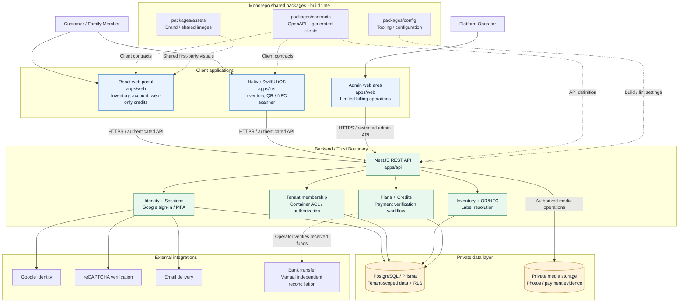

# BoxVault

QR/NFC-powered storage organization. One monorepo for the customer web portal, native iOS app, API, shared assets, and API contracts.

Current integration (2026-11-13): development branches are consolidated into `main` at the owner’s request. The Firebase Spark target is `boxvault-argee-2026`; only `apps/public-site` is published by its workflow. CI/CD activation awaits deploy-identity authorization. Customer UI remains a mock prototype and API production acceptance is pending. See [deployment setup](docs/firebase-spark-cicd.md).

## Stack
- Web: React 19, Vite, TypeScript, Bootstrap 5
- API: NestJS, TypeScript, Prisma 6, PostgreSQL
- iPhone: SwiftUI, Core NFC, AVFoundation (XcodeGen project definition)
- Package management: pnpm workspaces, Node 22
- Hosting: home/hybrid deployment later; production security hardening required

## Structure
- `apps/web` — customer and admin web application
- `apps/api` — NestJS REST API and Prisma schema
- `apps/ios` — native SwiftUI iPhone app
- `packages/assets` — shared first-party visual assets
- `packages/contracts` — OpenAPI / cross-platform generated clients
- `packages/config` — future shared lint/formatting config
- [`docs`](docs/README.md) — categorized product, architecture, security, audits, development and operations documentation
- `infrastructure` — deployment configuration

## Architecture overview

The diagram below shows BoxVault's **target logical architecture**, not a claim that all components are deployed. PR #4 implements portions of the authentication, tenant authorization, and RLS foundation; production readiness remains gated by the [security acceptance checklist](docs/security/security-release-checklist.md).



**Security boundaries:** Web and iOS clients never connect directly to PostgreSQL or private media storage. The API must enforce identity, tenant membership, per-container permissions, and entitlements before data access; PostgreSQL row-level security provides defense in depth. QR/NFC labels locate resources but are not authorization tokens. Admin workflows must not expose customer inventory content.

**Channel separation:** Credits, pricing, bank QR display, and payment evidence submission are web-only; iOS remains a companion inventory application. Private media storage and home/hybrid hosting are design targets, not confirmed production deployments.

For details, see the [solution architecture](docs/architecture/solution-architecture.md), [API contract](docs/architecture/api-contract.md), and [M1 security gate status](docs/security/m1-security-gate-status.md).

## Local setup (no Docker required)
Prerequisites: Node.js 22+, pnpm 10+, PostgreSQL 16+; Xcode and XcodeGen for iOS.

```sh
corepack enable
pnpm install
cp apps/api/.env.example apps/api/.env
cp apps/web/.env.example apps/web/.env
# Create a local PostgreSQL database matching DATABASE_URL.
pnpm db:generate
pnpm db:migrate
pnpm dev:api
# In a second terminal:
pnpm dev:web
```

Web: http://localhost:5173
API health: http://localhost:3000/api/v1/health

iOS: `cd apps/ios && xcodegen generate`, then open `BoxVault.xcodeproj` in Xcode. The iOS app expects a reachable API URL; the simulator uses localhost and physical devices need a LAN/TLS URL.

## Firebase Spark public-site CI/CD

The repository includes a **sanitized public coming-soon site** under `apps/public-site` and a guarded CI/CD workflow for Firebase Hosting on the **no-billing Spark plan**. Pull requests and matching pushes to `main` build and audit the static artifact. Live deployment is **disabled by default** and requires explicit GitHub variables, protected environment, a deploy identity and a successful Cloud Billing *disabled* check. This pipeline does not deploy the API, customer portal, SSR, or Developer Playground. See [Firebase Spark CI/CD setup](docs/firebase-spark-cicd.md).

## Developer Playground (mock-only)

The **VaultBox Developer Playground** centralizes QR Generator and responsive web UI mockups **plus restricted real local backend verification** in `apps/playground`, completely separate from normal production app builds. The NestJS backend still runs independently; the Playground offers a read-only health test. Start it with `pnpm install --no-frozen-lockfile && pnpm dev:playground` and open http://localhost:5174/. See [playground documentation](docs/developer-playground.md). Do not deploy the Playground publicly.

## Security
**This is an initial development scaffold, not production-ready.** Prisma models are not access controls. No private inventory or credit approval APIs are exposed until authentication, authorization, row-level security, and audit controls have been implemented. Never commit .env files, account details, user media, or payment receipts.

## Subscriptions
Personal PHP 999/year; Family PHP 1,999/year (up to four including owner). Credits are purchased and redeemed on the web only. iOS is storage/inventory-only, subject to Apple review.
