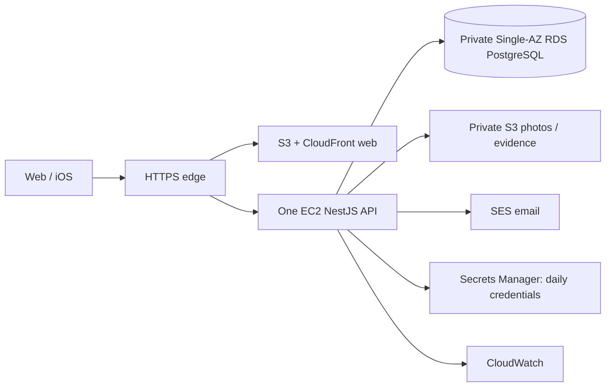

# BoxVault

<!-- BEGIN current AWS platform -->
> **Platform policy (2026-11-19):** Follow the [accepted AWS primary-platform decision](docs/architecture/aws-platform-decision.md) and [daily rotation policy](docs/deployment/secret-rotation.md): Sydney, one API host and Single-AZ RDS; Auto Scaling/Multi-AZ deferred. This document does not by itself prove hosted deployment, live rotation or production acceptance.
<!-- END current AWS platform -->

QR/NFC-powered private storage organization, with a React web portal, NestJS API and native iOS companion.

**Primary SaaS platform: AWS.** The owner selected Sydney (`ap-southeast-2`), one EC2 API instance and private Single-AZ RDS PostgreSQL. Auto Scaling and Multi-AZ are deferred. Daily credential rotation is required through Secrets Manager, with safe application refresh and key-version compatibility. [Accepted platform decision](docs/architecture/aws-platform-decision.md).

## Current state

- The connected local app supports real registration/verification, login/MFA, saved boxes/items, QR labels and Family controls, with scoped HTTP/session evidence.
- AWS Agent Toolkit is installed for Codex/Kiro. `boxvault-restricted` uses a verified read-only IAM role/boundary; it is not a deployment identity.
- AWS application infrastructure and live daily rotation are **not deployed/accepted**. The CloudFormation draft includes a daily RDS master-password schedule; runtime-user rotation, connection refresh and cryptographic key versioning remain required work.
- Firebase retains the disconnected mock dashboard and public mock Playground. Their static safeguards and workflows remain in place until AWS replacements pass acceptance.
- **Neon → Amazon RDS PostgreSQL; Brevo → Amazon SES.** Neon and Brevo are retired from the active stack.
- Existing local and historical Neon data remain intact. The AWS application starts with an empty database; no automatic data import is planned.

Passing CI, installed tooling, a valid template and a public mock are separate from production acceptance. Photos, complete payments/operator workflows, native-device integration and hosted provider/security/recovery gates remain unfinished.

## Run locally

Requirements: Node.js 22, pnpm 10.18, PostgreSQL 18 server tools.

```bash
pnpm install --frozen-lockfile
pnpm dev:local
```

Open **http://127.0.0.1:5180**. Create an account → Local inbox → verify → sign in → create a box/items → create/download/test a QR label. Data persists in `.boxvault-local/`; press Ctrl+C to stop and run the same command to resume. If port 5180 is busy, check whether BoxVault is already running.

This loopback sandbox uses synthetic mail and a test-only CAPTCHA mode; it sends no external mail and processes no payments. Phone QR scanning needs the later public HTTPS deployment. [Local guide and feature limits](docs/development/connected-local-app.md).

## AWS target



Keep auth/MFA and tenant/container RLS in the existing backend. The API authorizes every content operation; QR/NFC possession grants no access. Admin/support roles do not imply inventory browsing or AWS administration. TLS origin design, actual sender identity, uploads, secret refresh and release acceptance must be completed before public service.

[Service map](docs/deployment/aws-service-map.md) · [Migration](docs/deployment/aws-migration.md) · [Daily rotation](docs/deployment/secret-rotation.md) · [Toolkit and renewal](docs/deployment/aws-agent-toolkit.md) · [Operations](docs/operations/operations-and-deployment.md).

## Stack and source

- Web: React 19, Vite, TypeScript, Bootstrap 5.
- API: NestJS, Prisma 6, PostgreSQL; seven committed migrations with distinct auth/content/migration identities.
- iOS: SwiftUI, Core NFC and AVFoundation; XcodeGen project definition.
- Shared: assets, QR encoder and API/client contracts under `packages/`.
- AWS templates: `infra/aws/`. Retained Firebase preview guards: `infrastructure/firebase/`.
- Documentation: [index](docs/README.md), [architecture](docs/architecture/solution-architecture.md), [roadmap](docs/planning/delivery-roadmap.md), [release checklist](docs/security/security-release-checklist.md).

Manual API setup and Xcode steps are in the [development workflow](docs/development/development.md) and [iOS guide](apps/ios/README.md). Do not use the local launcher as an AWS deployment command or put secrets into frontend variables.

## Preview and Playground

The existing Firebase Spark dashboard/landing page and separate mock Playground remain legacy public previews. They contain fictional fixtures and no private backend connection. The connected local entrypoint has its own build. [Preview CI/CD](docs/firebase-spark-cicd.md), [Playground guide](docs/developer-playground.md). No DNS switch, Firebase deletion or backend exposure is implied by choosing AWS.

## Product boundaries

Free User has limited containers and advertisements; the exact free quota and ad integration remain pending. Single User: PHP 119/month or PHP 999/year (Best Value). Family: PHP 219/month or PHP 1,999/year, up to four total users including owner. Billing implementation and entitlement acceptance remain separate from price previews.

Credit purchase, bank transfer evidence, manual verification and redemption are web-only. iOS is an inventory/account-status companion without purchasing or external checkout calls to action. [Product requirements](docs/product/product-requirements.md).

Never commit credentials, keys, customer media, payment receipts or raw tokens. The [security standard](docs/security/security-first-standard.md) and [release checklist](docs/security/security-release-checklist.md) apply to the AWS target; no production readiness claim is made here.
