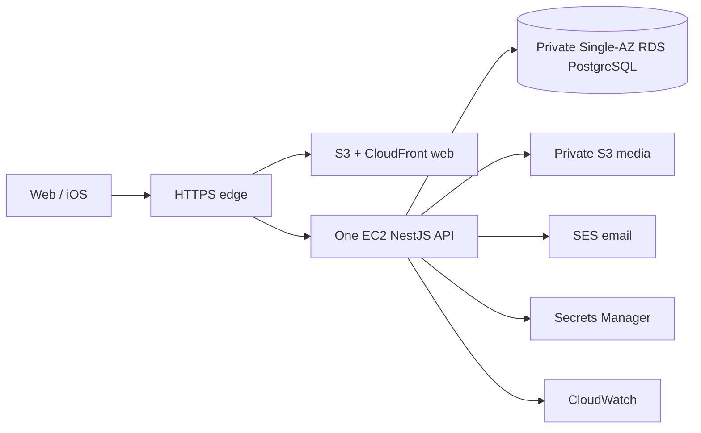

# BoxVault architecture

<!-- BEGIN current AWS platform -->
> **Platform policy (2026-11-19):** Follow the [accepted AWS primary-platform decision](aws-platform-decision.md) and [daily rotation policy](../deployment/secret-rotation.md): Sydney, one API host and Single-AZ RDS; Auto Scaling/Multi-AZ deferred. This document does not by itself prove hosted deployment, live rotation or production acceptance.
<!-- END current AWS platform -->

Current platform: **AWS**, Sydney (`ap-southeast-2`), with one API host and Single-AZ PostgreSQL initially. Auto Scaling and Multi-AZ are deferred. The [accepted platform decision](aws-platform-decision.md) is authoritative; the [service map](../deployment/aws-service-map.md) gives component responsibilities.

## Application boundaries

- `apps/web`: React/Vite customer and admin/support interfaces, with web-only top-ups and plan redemption. Public mock and connected app are separate entrypoints.
- `apps/api`: NestJS/Prisma API, existing auth/MFA/session code, tenant/member/container policies and all persistent business rules.
- `apps/ios`: SwiftUI inventory/QR/NFC companion; no purchasing or payment links.
- `packages/assets`, `packages/qr`, `packages/contracts`: first-party visuals, QR encoding and client/API conventions. User content never belongs in these packages.

## AWS target

The API enforces identity → session → authorized tenant membership → action/object permissions → transaction-scoped RLS → storage authorization. A QR/NFC locator grants no access. Platform admins/support cannot browse private inventory through their application roles. S3 website assets and customer objects use separate storage/access boundaries.

## Rotation and recovery

Daily database credential rotation is required. RDS manages the master secret; runtime auth/content users require separate rotation and connection-refresh code. JWT, pepper and TOTP keys require version-aware rollover before automatic changes. [Rotation policy](../deployment/secret-rotation.md). Private RDS ingress, encrypted storage/backups, restore exercises, bounded/redacted logs and least-privilege runtime identities remain release requirements.

## Verified implementation limits

The connected local app has real signup, verification, login/MFA, box/item and QR/Family HTTP flows with recorded scoped tests. The AWS toolkit and its read-only IAM boundary are installed. The AWS application database, media service, runtime roles, daily live rotation, real email and hosted production cutover are **not** complete. Firebase continues to serve a disconnected mock preview. Historical Neon/Brevo evidence is preserved. See [local app](../development/connected-local-app.md), [migration](../deployment/aws-migration.md) and [release gates](../security/security-release-checklist.md).

Product prices, four total Family members including owner, web-only credits and iOS restrictions are defined in [product requirements](../product/product-requirements.md) and are unaffected by AWS adoption.
