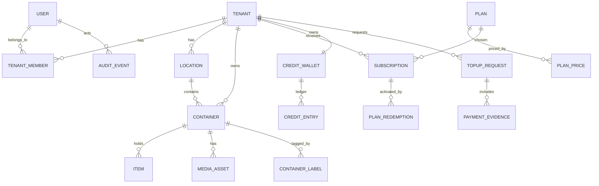

# Database and Data Model Specification

**Implementation snapshot (2026-11-12; PR #4):** The description below is the *target logical model*, but the M1 branch now includes **six versioned Prisma migrations** (`202611110000`–`202611110005`), auth/session/MFA/recovery/audit records, tenant membership constraints, and tenant-aware RLS/ACL controls. The isolated `m1-security-test` Neon branch has verified A/B/C history, deployment and restricted-role grants. This does **not** establish production schema migration, all financial/media models or independent acceptance of live HTTP authorization. See [database audit](../audit/database/phase-b-schema-deployment.md) and [roadmap](../planning/delivery-roadmap.md).

Status: **target schema**; M1 branch now includes staged auth/tenant migrations and PostgreSQL RLS; complete target schema and production acceptance remain pending.

## 1. Principles

- Primary keys: UUID. Store `tenant_id` on tenant-owned rows, indexed, immutable after creation.
- Foreign keys should include tenant scope where possible (`(tenant_id, container_id)`), preventing cross-tenant relationships.
- Normalize money as **integer minor units (centavos)** or exact decimal, never floating point. Credits use integer units.
- Use UTC `timestamptz` and explicit `Asia/Manila` reporting intervals.
- Prefer soft deletion for content until retention policy and backup lifecycles are defined; never silently mutate an immutable financial journal.
- Do not store plaintext passwords or bank account secrets in operational logs.

## 2. Entity map



## 3. Logical tables and fields

| Table | Important fields and rules |
|---|---|
| `users` | `id`, unique normalized `email`, `password_hash`, `email_verified_at`, status, timestamps |
| `sessions` | `id`, user, hashed refresh token, device metadata, expires/revoked timestamps |
| `tenants` | `id`, display_name, kind PERSONAL/FAMILY, status, created_at |
| `tenant_members` | `tenant_id`, `user_id`, role OWNER/EDITOR/VIEWER, status; unique(tenant,user); seat limit enforced transactionally |
| `invitations` | tenant, email, role, token_hash, expiry, accepted_at, invited_by; uniqueness for pending invites |
| `locations` | id, tenant_id, optional parent_id, name, sort_order; no cross-tenant parent |
| `containers` | id, tenant_id, location_id, display_name, description, status, timestamps |
| `container_labels` | id, tenant_id, container_id, token_hash, type QR/NFC, issued_at, revoked_at; allow rotation |
| `items` | id, tenant_id, container_id, name, quantity, notes, category, timestamps |
| `media_assets` | id, tenant_id, container_id, optional item_id, private object key, mime, bytes, checksum, status and variant |
| `plans` | code PERSONAL/FAMILY, active, max_users, max_containers, max_storage_bytes |
| `plan_prices` | plan_id, annual_credits, currency, effective_from/until, version; freeze historical redemption amounts |
| `subscriptions` | tenant_id, plan_id, status, start_at, expires_at, cancel_at; entitlement snapshot |
| `credit_wallets` | tenant_id unique, cached_balance integer >= 0; balance must reconcile to journal |
| `credit_entries` | wallet_id, type CREDIT/DEBIT/REVERSAL, positive amount, signed delta or direction, unique event id, source ref, actor, timestamp |
| `topup_requests` | tenant_id, package snapshot, requested_minor_units, requested_credits, bank_reference, state, review metadata, timestamps |
| `payment_evidence` | request_id, private object key, upload timestamp, moderation status/retention |
| `plan_redemptions` | tenant, subscription, credits_debited, plan_price_version, client idempotency key, timestamp |
| `audit_events` | event type, actor, role, tenant optional, target type/id, correlation id, safe outcome and timestamp |
| `consents` | user_id, version, purpose, granted/revoked_at and source |
| `notifications` | user/tenant, template id, event id, delivery state, sent_at |

## 4. Constraints and indexes

- Unique active label token hash; never use predictable sequential label IDs.
- Unique `(tenant_id, user_id)` memberships, `(tenant_id, location_id, id)` foreign-key composites where useful.
- Search indexes: `(tenant_id, lower(name))`, trigram/full-text search or GIN as required. Prevent indexed search from leaking other tenants' suggestions or counts.
- Credit source-event `UNIQUE`; plan redemption `UNIQUE (tenant_id, client_idempotency_key)`.
- Payment-proof object paths generated server-side, e.g. `private/tenant_uuid/topup_uuid/random_id`; never take arbitrary paths from clients.
- One open subscription entitlement per tenant as an invariant (history rows allowed); enforce through transaction and partial index where applicable.
- Avoid global uniqueness on a bank transfer reference alone unless bank account, time period and scheme semantics justify it; build robust duplicate detection including receiving account, amount and payment identifiers.

## 5. Row-Level Security (mandatory before protected APIs)

Use PostgreSQL RLS on all tenant tables. API login role must **not** have `BYPASSRLS`, must not own the protected tables, and should operate with `FORCE ROW LEVEL SECURITY` when appropriate. Resolve user membership in trusted middleware then bind tenant context **inside the same database transaction/connection** as the query.

Example **illustrative**, not ready-to-run migration:

```sql
ALTER TABLE containers ENABLE ROW LEVEL SECURITY;
ALTER TABLE containers FORCE ROW LEVEL SECURITY;

CREATE POLICY tenant_container_isolation ON containers
  USING (tenant_id = NULLIF(current_setting('app.tenant_id', true), '')::uuid)
  WITH CHECK (tenant_id = NULLIF(current_setting('app.tenant_id', true), '')::uuid);
```

An attacker must not be able to set arbitrary `app.tenant_id` on a direct database connection: never expose SQL; keep app DB credentials private; set context only after verified membership; ensure connection-pool context cannot leak between requests. For privileged maintenance tasks, use audited, narrowly scoped service credentials and explicit policies rather than a blanket admin bypass. Also apply equivalent RLS to media metadata, items, wallets and memberships with appropriate system-tenant exceptions.

## 6. Credit ledger design

Credit entry represents **direction + positive amount** or a signed delta, not both ambiguously. Use decimal accounting separately for peso cash (top-up receipts) and integer credits for entitlements. Wallet cached balance = sum of all signed ledger deltas. Enforce `balance >= 0` transactionally.

Approval workflow uses single serializable or row-locked transaction: ensure request PENDING → confirm unique verified bank transfer → append CREDIT entry → increment balance → mark APPROVED → append safe audit. Retried idempotent requests must return the same outcome.

Redemption workflow: verify active price version + tenant role + sufficient balance; lock wallet; append DEBIT; extend subscription; write redemption and audit in a single transaction.

## 7. Migration from starter schema

1. Introduce auth sessions/verification and tenant ownership constraints.
2. Separate container identity from label tokens; add location hierarchy and private media metadata.
3. Add plan price versioning, ledger source refs, proof metadata and subscription redemption history.
4. Add indexes, partial uniqueness, database CHECKs and RLS migrations using raw SQL where Prisma cannot express them.
5. Add integration tests using **two tenants** and separate runtime/migration database roles. Validate negative access paths, token rotation, concurrent approvals and membership removal.
6. Do not migrate production data until restoration and migration rollback procedures are tested.

## 8. Retention and privacy

Create a retention matrix for users, uploaded inventory, deleted media, financial transaction data, bank payment proofs, audit events and backups. Some payment and legal records may need to outlive account deletion; disclose and implement those exceptions. Avoid recording inventory names or image content in platform operational logs.
