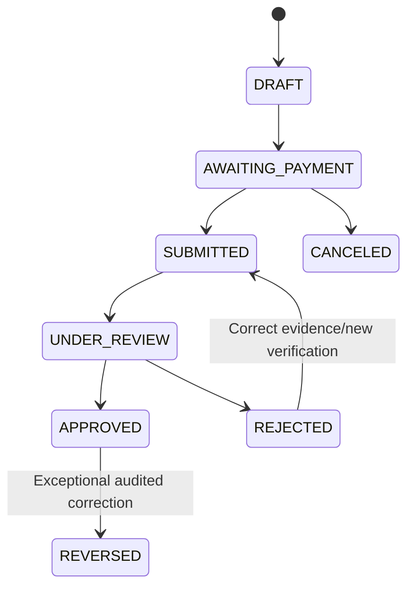

# Manual Credits, Annual Subscriptions and Financial Reporting

Status: proposed design. No payment gateway is connected or needed for MVP.

## 1. Fixed annual prices

| Plan | Users | Annual price | Credits to redeem |
|---|---:|---:|---:|
| Personal | 1 | **PHP 999** | **999** |
| Family | Up to **4 including owner** | **PHP 1,999** | **1,999** |

Target customer-facing rate lock: **2027, 2028 and 2029**; review afterward rather than raising prices annually. Expenses may escalate **10% per year**, compounded, for business modeling. No implicit price changes within a paid annual term.

Illustrative credit unit: **1 credit issued per PHP 1 received**. Units are a closed-loop software entitlement usable only for BoxVault plans; no peer-to-peer transfer, cash withdrawal or general-purpose payment. Any rights to refunds and credit expiration must be legally reviewed and prominently disclosed; do not automatically expire purchased credits by default.

## 2. Channel separation

| Action | React customer web | SwiftUI iOS |
|---|---|---|
| Purchase credits / view prices | Yes | **No** |
| Display receiving bank QR | Yes | **No** |
| Upload bank receipt/reference | Yes | **No** |
| Wallet history / redemption | Yes | **No** |
| Read active entitlement (plan/status/date) | Yes | Yes, neutrally |
| Manage inventory / QR/NFC | Yes (QR where supported) | Yes |
| Admin verify transfer | Authorized admin web | **No** |

Web-only payment is an **architectural choice, not guaranteed App Store compliance**. Obtain review for an appropriate companion-app exception; do not insert iOS banners or links directing purchases to web.

## 3. Top-up lifecycle



**Flow:** customer creates web request → app shows bank QR/reference instructions → customer pays outside BoxVault → customer submits bank reference and proof → operator independently checks bank history, receiving account, amount and reference → approve/reject. Screenshots are **not evidence of cleared funds** without independent confirmation. Never credit merely because an image was uploaded.

Receipt upload is private with strict validation. Restrict operator access to payment evidence by finance permission, log every view and set defined retention.

## 4. Wallet and ledger integrity

Wallet is per tenant (single owner controls redemption). Maintain immutable append-only `credit_entries`; derive a balance from signed entries and optionally cache `wallet.balance` with reconciliation.

**Approval pseudocode:**

```text
transaction:
  lock topup row
  ensure PENDING / UNDER_REVIEW and independently verified
  confirm bank reference+amount not already approved for same transfer
  lock tenant wallet
  insert unique CREDIT ledger entry for topup
  increment wallet balance
  set topup APPROVED; record reviewer/time
  insert audit event
commit
```

Replay of the same approval/idempotency key returns existing result, not another credit. Two simultaneous reviewers must not double-credit.

**Redemption pseudocode:**

```text
transaction:
  lock wallet and subscription
  verify tenant owner and active annual plan price version
  require wallet balance >= price in credits
  insert unique DEBIT ledger entry
  update wallet cached balance
  activate / extend subscription
  record price snapshot and redemption
commit
```

If renewing same plan, start new annual coverage at `max(now, current_expiry)`. Plan changes need an explicit proration/upgrade policy; avoid automatic prorated math before product approval.

## 5. Entitlement states

- `INACTIVE`: no active paid plan; optional limited trial decided separately.
- `ACTIVE`: paid plan within validity; backend enforces seats, boxes, bytes.
- `EXPIRING`: informational period before expiry, not a billing state.
- `EXPIRED`: end of paid coverage; recommended read-only grace and export policy; no automatic data deletion.
- `CANCELED`: future renewal disabled; service can remain active until paid expiry if terms allow.
- `SUSPENDED`: exceptional abuse/security response, audited and appealable.

Subscription dates should use explicit UTC instants with customer-local presentation and stated renewal semantics (calendar year vs 365 days); choose one consistently before implementation.

## 6. Admin dashboard and financial definitions

- **Cash collected**: verified bank receipts allocated to approved top-ups by money-received/verified date. Track cash receipt timing separately from approval timestamp.
- **Credits issued**: posted credit ledger increases, including promotional credits separately.
- **Credits redeemed**: ledger debits to activate annual plans.
- **Outstanding credits**: unredeemed customer balances; not counted again as new cash.
- **Subscription bookings**: value of redeemed plans.
- **Earned revenue**: revenue recognized over the service term according to applicable accounting policy; do not equate this automatically with money received.
- **Refunds/reversals**: distinct negative records, not destructive edits.
- **Active paying tenants**: tenants with paid active entitlements (not number of family members).
- **Inactive users**: user activity status over selected window (e.g. 30/60/90 days) independent of entitlement.
- **Churn**: previously paid tenant no longer active or renewed, with explicit cohort definition.
- **Retention/win-back**: aggregate eligible former subscribers; respect marketing consent and opt-out.

Aggregation windows: daily/weekly/monthly/yearly in `Asia/Manila`, with consistent start/end boundaries and exportable CSV.

## 7. Operating-cost model and fixed-rate policy

Earlier **planning estimates** (not invoices) used:
- Cloud-fixed: PHP 7,000/month or home-hosting placeholder PHP 2,000/month.
- Other business OPEX: PHP 15,000/month.
- Per-tenant variable annual budget: Personal PHP 96; Family PHP 360 (previous 5-member cost estimate, conservative for 4).
- Home server hardware recovery scenario: PHP 45,000 one-time.
- Cost escalation: 10% annually; sales prices remain PHP 999/PHP 1,999.

For year index `n = 0,1,2`:

```text
revenue(n) = 999 * personal_paying_tenants(n) + 1999 * family_paying_tenants(n)
fixed_opex(n) = fixed_opex_year_1 * 1.10^n
variable_opex(n) = (96 * personal(n) + 360 * family(n)) * 1.10^n
contribution(n) = revenue(n) - fixed_opex(n) - variable_opex(n) - one_time_cost(n)
contribution_margin(n) = contribution(n) / revenue(n)
```

This is a **full-year-equivalent** model. For growing customer cohorts, actual collections, outstanding prepaid credit liability, renewals and earned revenue must be tracked separately. Do not count a credit top-up and its eventual redemption as two sales.

Model hosting scenarios independently; avoid adding cloud baseline and home baseline simultaneously. Home hosting must include hardware, UPS, internet backup, off-site storage, administration time, repair and outage risk. Budget version and assumptions should be stored in documented planning spreadsheets rather than product source code.

## 8. Regulatory and risk checkpoints

Before accepting public payments in the Philippines: obtain guidance on business/BIR obligations, consumer refund and service-credit terms, Privacy Act compliance, and whether the closed-loop credits design raises any stored-value/payment regulation concerns. A bank account or QR transfer does not bypass these requirements.
