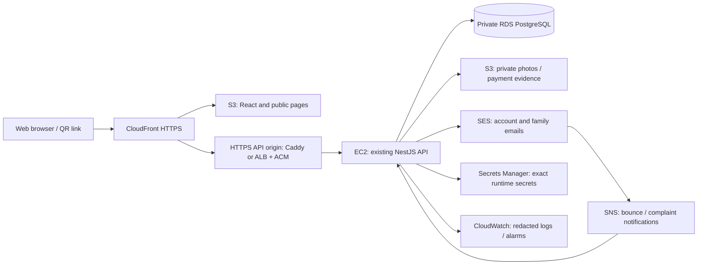

# BoxVault AWS service map

<!-- BEGIN current AWS platform -->
> **Platform policy (2026-11-19):** Follow the [accepted AWS primary-platform decision](../architecture/aws-platform-decision.md) and [daily rotation policy](secret-rotation.md): Sydney, one API host and Single-AZ RDS; Auto Scaling/Multi-AZ deferred. This document does not by itself prove hosted deployment, live rotation or production acceptance.
<!-- END current AWS platform -->

Accepted target architecture; deployment pending, 2026-11-19 (Asia/Manila). This maps the existing React/NestJS/Prisma/PostgreSQL application to AWS. It does not deploy anything. Selected project Region: **ap-southeast-2 (Sydney)**; CloudFront is global and its control plane/certificates use us-east-1 where required. No Lambda@Edge, cross-region replication or Organizations is planned.

The project API currently reports Free / ACTIVE with USD 200 credits. Credits fund eligible usage; this is not a permanently zero-cost architecture. Service inclusion in the new-experience Free plan does not establish that every configuration or usage level is covered.

## Provider replacements

**Neon → Amazon RDS PostgreSQL. Brevo → Amazon SES.** Neither old provider remains an active dependency or fallback. Historical test commands/records are retained solely as evidence. New hosted configuration uses RDS/SES; local development uses the isolated launcher.

## Selected first implementation

**Owner decision (2026-11-19):** one API instance, RDS Single-AZ, no Auto Scaling or Multi-AZ for the initial release. Daily credential rotation is required; see [rotation policy and implementation gates](secret-rotation.md).

Keep the existing modular NestJS API on a small EC2 host, PostgreSQL on private RDS, private files in S3, and transactional email in SES. Keep current password/MFA/session/Family authorization code. This minimizes migration changes; a later Lambda or container move can be evaluated separately.

For the website, use a private S3 REST origin plus CloudFront OAC. Route `/api/*` to the HTTPS API origin with caching disabled, the required Authorization/header/cookie forwarding and the same public origin as the frontend. Static assets may be cached; tenant APIs, sessions and private photos must not be cached as public content.

TLS is a real design decision, not an omitted cost: for the lean prototype, EC2 can run Caddy with a valid domain certificate from an ACME CA. Caddy is application software on AWS, but its certificate issuer is external. If all certificate management must also be AWS-native, use **an Application Load Balancer plus ACM** in front of EC2 and include their running costs. ACM exportable certificates are excluded in this project's new AWS experience; do not assume an ACM certificate can simply be installed on the instance. A custom domain/sender domain has not been supplied. Use the CloudFront HTTPS hostname for the viewer initially; EC2 origin HTTPS still needs a valid hostname/certificate. Resolve this before public deployment.

Public origin access must be restricted so API callers cannot bypass edge protections: restrict ingress and verify a private origin header where appropriate. No private photo objects are exposed through the public static origin. Authenticated photo reads should pass through the API when immediate membership revocation is required. A presigned download remains valid until expiration and therefore does not provide immediate revocation on its own.

## Required capabilities and selected services

| Capability | Service / implementation | Scope and first-release decision |
| --- | --- | --- |
| Landing page, customer/admin/support web UI | S3 + CloudFront | Separate static website storage from private user uploads; use a private S3 REST origin with OAC, SPA routing and security headers. Business actions remain API-authorized. |
| Developer Playground | Separate S3 origin / CloudFront distribution | Keep its mock-only build, URL and deployment isolated; never give it production credentials or private API access. Keep current Firebase link until replacement passes checks. |
| API and business rules | EC2 + encrypted EBS | Run the existing NestJS/Node.js app and a small background process if needed. EBS stores OS/code and bounded temporary files, not the authoritative database or photos. Build in CI, not on a memory-constrained server. |
| PostgreSQL and persistent business records | RDS for PostgreSQL | Users, tenants, memberships, containers/items, grants, label hashes, sessions, plans, wallets, top-ups and audit records. Preserve distinct SQL migration/auth/content identities and RLS. Start with an empty database as requested. |
| Private photos and documents | S3 | Original item/container photos, thumbnails and private payment evidence. Block public access, validate upload size/type, enforce tenant/object authorization, track metadata/quotas in RDS. APIs and upload UI still need implementation. |
| Verification, reset, invitations and receipts | SES | Verified sender, regional credentials or runtime IAM, delivery limits, suppression handling and production approval for arbitrary recipients. No local inbox in public hosting. |
| Bounce / complaint feedback | SNS + signed API webhook | Deliver SES feedback to the app; validate the topic/signature, redact logs and update suppression state. No Lambda is required if the API receives the webhook. |
| Network separation | VPC, subnets, security groups, route tables | RDS is private; PostgreSQL ingress only from the API group. Use a narrowly exposed API host and Session Manager administration. A public-subnet API host can avoid a NAT gateway, but its public IPv4 is still charged. |
| HTTPS / DNS | CloudFront TLS; Route 53 if using an owned domain; Caddy initially OR ALB + ACM | Default CloudFront hostname avoids buying a viewer domain immediately. Domain registration/hosted zones and ALB are separate costs. Keep origin TLS valid. SES sender verification is independent of visitor HTTPS. |
| Runtime credentials and encryption | Secrets Manager + service encryption / KMS | Daily database credential rotation, with runtime refresh and failure alarms. Prefer SES API/temporary IAM credentials over static SMTP passwords. JWT, pepper and TOTP keys require version-aware rotation code. See the dedicated rotation policy; no blind daily overwrites. |
| Workload / deployment permissions | IAM roles + STS | Separate read-only agent, API runtime, deployment and migration duties. The current toolkit role stays read-only. Never create an IAM identity for each BoxVault customer or map app admins to AWS admin access. |
| Logs, availability checks, alerts | CloudWatch Logs, metrics and alarms | Redact credentials/proofs, set retention and size limits, monitor API health, errors, instance memory/disk, database connections and email failures. Billing estimates must include log ingestion. |
| AWS administrative audit | CloudTrail | Use management-event history initially; configure a trail/retention if needed. Data-event logging has separate scope/cost. CloudTrail does not replace BoxVault's application audit/financial ledger in PostgreSQL. |
| Backups and recovery | RDS automated backups/snapshots + S3 versioning/lifecycle | Test restoration, define retention and keep backups in Sydney. Object versioning protects against some mistakes but is not an immutable independent backup. AWS Backup is optional if native coverage is insufficient. |
| Deployments and changes | CloudFormation + existing GitHub Actions + IAM OIDC | Versioned infrastructure, tests, build, controlled release and rollback. Use short-lived deployment credentials and separate code/artifact storage. CodePipeline/CodeBuild are not required while existing CI meets the need. |
| Server access and maintenance | Systems Manager | Session Manager and patch/deployment administration with scoped permissions. A network path to SSM endpoints is still required. Avoid an internet-open SSH port. |
| Spend visibility | AWS Settings + Budgets | Monitor remaining credits/expiry, set alerts and review service estimates. Budgets do not universally stop spending. Do not upgrade the project or enable advanced features automatically. |

The capability map is the accepted service selection, not evidence that those services are configured or that the application features are complete. AWS lists the principal services above in the new-experience Free-plan catalog, subject to feature restrictions and regional availability. Check the exact instance, engine, quotas, configuration and cost before creating a change set.

## Before public signup

Keep authentication/authorization and rate limiting in the API. The current connected UI is local-only and does not supply production CAPTCHA proofs. Choose and implement either its existing CAPTCHA integration or an AWS-native **WAF** challenge/CAPTCHA integration attached to CloudFront/ALB, with origin-bypass prevention and backend validation/trust boundaries. Merely attaching WAF does not replace the current server-side bot-verification logic. An entirely AWS-hosted bot-protection route therefore requires code and a WAF cost estimate.

SES sandbox initially permits only verified recipients/simulator and has low quotas. Public signup requires the actual sender to be verified and production sending access to be granted. Real mail delivery, reset, MFA, invitation acceptance/revocation and phone QR scanning must pass on the final HTTPS origin before launch acceptance.

## Optional services, with triggers

| Service | Add when | Why it is not an initial dependency |
| --- | --- | --- |
| SQS + dead-letter queue | Reliable asynchronous thumbnails, email or reconciliation jobs need retries independent of API requests | A worker can initially run with the API; queue integration and transactional delivery semantics still need code. Do not log token-bearing job payloads. |
| Lambda | Image processing, feedback or webhook/event workers should execute independently | Existing API can remain on EC2. Check native image dependencies, execution limits and private-DB connectivity/egress cost before moving workloads. |
| EventBridge Scheduler | Expiration cleanup, reminder and reconciliation jobs need managed scheduling | Request-time entitlement enforcement is still necessary; a scheduled job must never be the only check that stops expired access. |
| ECR + ECS/Fargate | Container deployments and scaling justify a container runtime | Adds image pipeline, networking and runtime choices beyond a single existing API host. |
| Auto Scaling / RDS Multi-AZ | Deferred by the owner for this small project | Excluded from the initial deployment. ALB remains a separate optional TLS choice; it does not require Auto Scaling. |
| ElastiCache / Redis | Measured caching, coordination or throughput needs justify it | Do not cache authorization without revocation design; PostgreSQL remains authoritative. |
| Cognito | A separate migration to AWS-managed identity is explicitly desired | Existing password hashes, TOTP factors, sessions and tenant identities need a migration plan. It does not replace Family/container authorization. |
| API Gateway / Lambda Web Functions | A deliberate serverless API architecture is selected | Avoid layering them onto an EC2 HTTP API without a requirement. Web Functions currently require Node 24/arm64 and their own deployment/networking checks; the current API targets Node 22. |
| AWS Backup / enhanced security products | Recovery or compliance requirements exceed native controls | Some security services are excluded from the current new AWS experience; do not activate advanced features or upgrade the Free plan as a workaround. |

Do not provision DynamoDB, EKS, OpenSearch, Aurora, RDS Proxy, NAT Gateway, cross-region replicas or a customer-managed key by default just to make the architecture look complete. Reassess only when a requirement and cost estimate justify the component.

## Application functionality is not a separate AWS service

- **Signup/login/MFA:** current NestJS auth plus RDS and SES.
- **Family roles and access revocation:** current API and RDS membership/object policies.
- **QR generation:** existing QR library; store hashed locators in RDS and use the final HTTPS URL. No AWS QR-generation service is needed.
- **Photo uploads:** private S3 plus newly implemented API/UI authorization and quota handling.
- **Credits and subscriptions:** application ledger and plan rules in RDS. Manual top-up/payment verification or an external payment provider remains necessary; AWS billing/credits are not customer BoxVault credits. Payment evidence stays private in S3.
- **Free-user advertisements:** an ad provider/commercial arrangement is separate from hosting the app on AWS.
- **Admin/support access:** application-side roles and audit boundaries, not AWS IAM admin permissions. Operators should not receive implicit inventory or photo browsing access.
- **Product analytics:** start with explicitly defined, consent-aware application events/aggregates; CloudWatch operational metrics are not a complete product analytics system.

## Rollout order

1. Finalize the API/TLS/domain choice and estimate Sydney's fixed costs plus requests/storage/egress. Resolve sender identity. No plan change is authorized by this mapping.
2. Prepare separately scoped deployment and runtime roles; keep the existing toolkit role read-only.
3. Create private RDS, apply/review the seven migrations and runtime grants, prove positive/negative tenant and membership tests.
4. Deploy the real API and connected frontend, replace local-only controls and connect actual production bot protection.
5. Connect SES and feedback, implement private uploads and their UI, and verify real account → container/items → photo → QR → Family share/revoke workflows.
6. Connect the credit/top-up/plan flows and operator review with idempotency and an auditable financial ledger.
7. Verify logs, alarms, backups/restore, denial tests, device/browser behavior and rollback before cutover. Preserve local/Neon data and current hosting until acceptance.

## Cost boundaries and unresolved choices

The principal baseline costs are the EC2 host, RDS instance/storage/backups, EBS/public IPv4 and any ALB/WAF/network endpoints; S3, SES, CDN, secrets and logs add usage-dependent costs. Credits may cover eligible usage for a limited period. Do not quote a monthly total without traffic, storage, retention, deployment sizes and a region-specific estimate.

CloudFront itself is in the new-experience Free-plan service list; its separate flat-rate service plans (including the plan marketed at USD 0/month) are not available to Free Tier projects under their current plan requirements. Do not select that pricing program as a presumed no-charge bundle.

This map leaves decisions open where owner input or measurement is missing: public domain/sender identity, TLS variant, traffic/user count, photo quota and retention, acceptable downtime/recovery target, and exact regional RDS/EC2 sizes. No resources were created by this mapping task.

## Primary references checked

- [New AWS experience service availability](https://docs.aws.amazon.com/accounts/latest/reference/supported-services-sign-up-new.html)
- [S3 private origins with CloudFront OAC](https://docs.aws.amazon.com/AmazonCloudFront/latest/DeveloperGuide/private-content-restricting-access-to-s3.html)
- [SES sandbox and production access](https://docs.aws.amazon.com/ses/latest/dg/request-production-access.html)
- [CloudFront flat-rate project requirements](https://docs.aws.amazon.com/PricingPlanManager/latest/UserGuide/plans.html)
- [VPC, public IPv4 and NAT pricing](https://aws.amazon.com/vpc/pricing/)
- [ACM use with EC2](https://repost.aws/knowledge-center/configure-acm-certificates-ec2) and [new-experience ACM restrictions](https://docs.aws.amazon.com/accounts/latest/reference/supported-services-sign-up-new.html)
- [WAF supported protected resources](https://docs.aws.amazon.com/waf/latest/developerguide/web-acl-associating-aws-resource.html)
- [CloudTrail management-event history](https://docs.aws.amazon.com/awscloudtrail/latest/userguide/view-cloudtrail-events.html)

AWS MCP skills consulted: `rds-oss`, `aws-storage`, `aws-compute`, `aws-lambda-web-functions`. Their production recommendations do not authorize paid provisioning or override the owner's Free-plan constraint.
