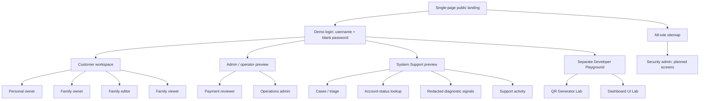

# BoxVault role-based sitemap

Updated 2026-11-13. Browse the interactive map at `/#/sitemap`.

This map separates **implemented mock UI** from **planned connected-product screens**. It is a human-facing information architecture, not a search-engine XML sitemap. The public UI has no live authentication or authorization. A demo username chooses a preview; it does not grant real account permissions.

## Role and access matrix

| Role / persona | Workspace and screens | Intended access | Excluded access |
|---|---|---|---|
| Guest | Landing, FAQ, demo login; planned registration, verification, recovery and scan handoff | Public information and identity entry | Private customer or operator records |
| Personal owner | Dashboard, boxes/details, inventory/search, locations, QR preview, plans/credits, settings; planned profile/security and payment/redemption flows | Own workspace and subscription | Other tenants, Family membership administration, platform consoles |
| Family owner | Customer screens plus Family preview; planned invitations, seat management, container grants and ownership transfer | Own content, explicit grants, membership and subscription; maximum four members including owner | Other members' unshared private containers, other tenants, platform administration |
| Family editor | Shared workspace, granted boxes/items, search and settings; planned authorized edits/scan resolution | Edit explicitly shared content; own profile/security | Unshared content, subscription and membership administration |
| Family viewer | Read-only shared workspace, boxes/details, inventory and settings | Read explicitly shared content; own profile/security | Content mutations, invitations, grant changes, billing administration |
| Payment reviewer | Platform overview, payment queue/details/confirmation, plan/credit ledger, account metadata and activity | Financial review with verification, step-up and audit in the future backend | Customer inventory, media, private notes; operator provisioning |
| Operations admin | Platform overview, account metadata, plan reporting and safe activity; planned retention/incident reports | Operational and subscription health | Financial approval, silent balance edits, customer content, operator provisioning |
| **System Support** | **Support overview, case queue/triage, account-status lookup, simulated diagnostics and support activity** | Support-ID lookup, safe account/plan status, redacted error/correlation codes, case notes and escalation | Inventory, media, private notes, payment proofs/approvals, credit/plan edits, passwords, impersonation and role grants |
| Security admin | Planned operator directory, dual-approval provisioning, MFA/session governance, policy/key review, incidents and audit exports | Security governance through separately approved server-side actions | General inventory access and financial approval via the security role |
| Developer (tooling persona) | Separate Playground catalog, QR lab, UI lab, role map; local-only backend tester | Fictional developer tools; explicitly started local diagnostics | Live customer data/secrets and hosted backend proxies |

Customer member visibility in the UI uses shared sample boxes. Viewer creation controls are disabled. The wider role boundaries in this table are design requirements for a future authenticated backend, not security supplied by hash routes.

## Route inventory

| Surface | Route | State |
|---|---|---|
| Single-page landing | `/` | Mock website with how-it-works, features, plans and FAQ sections |
| Demo login | `/#/login` | UI routing only; password must be blank |
| Role sitemap | `/#/sitemap` | Interactive map for all ten roles/personas |
| Customer dashboard | `/#/app/overview` | Mock UI |
| Boxes / inventory / locations | `/#/app/boxes`, `/#/app/inventory`, `/#/app/locations` | Mock UI |
| Labels / Family / plans / settings | `/#/app/labels`, `/#/app/family`, `/#/app/plans`, `/#/app/settings` | Mock UI / workflow placeholders |
| Admin console | `/#/admin/overview` | Account/billing metadata mock |
| Admin sections | `/#/admin/accounts`, `/#/admin/payments`, `/#/admin/credits`, `/#/admin/activity`, `/#/admin/settings` | Mock UI |
| System Support | `/#/support/overview` | Separate support role preview |
| Support sections | `/#/support/cases`, `/#/support/accounts`, `/#/support/diagnostics`, `/#/support/activity` | Mock UI with session-only case updates |
| Developer Playground | `https://boxvault-playground-argee-2026.web.app/` | Separate public mock Hosting site |
| QR / UI labs | Playground `/qr/`, `/ui/` | Browser-only tools |
| Local backend tester | Local Playground `/backend/` | Local development only; omitted from public build |

## Demo username routing

Every listed username requires a **blank password**. Names are case-insensitive; underscores/hyphens normalize to spaces.

| Username | Destination |
|---|---|
| `admin` | Admin overview |
| `single user` (also `single`, `singleuser`, `personal`, `user`) | Personal owner customer preview |
| `family user` (also `family`, `familyuser`, `family owner`) | Family owner customer preview |
| `support` (also `system support`) | System Support overview |
| `editor` / `viewer` | Shared Family sample views; Viewer is read only |
| `payment reviewer` | Admin payment queue |
| `operations` | Admin operational overview UI reference |
| `security` | Sitemap selected on the planned Security admin role |
| `developer` | Separate public mock Playground |

Unknown usernames or a nonblank password show an error. No authentication request is sent, no account is created and no credential is persisted.

## System Support implementation boundary

`SYSTEM_SUPPORT` is introduced in the frontend role registry and mock support workspace. No backend enum migration, platform-operator provisioning, identity claim or live permission grant is performed by this UI work. Production enablement requires separate backend role checks, scoped diagnostic adapters, mandatory operator MFA and an independently enforced audit trail.

## UI verification for this release

Browser checks verified redirects for `admin`, `single user`, `family user`, `support`, `editor`, `viewer`, `payment reviewer`, `operations` and `security`. Viewer box-creation controls were disabled. Nonblank passwords and unknown usernames showed errors without navigating. Landing, login, sitemap and Support overview had no page-width overflow at a 375px viewport. These checks validate the mock experience, not production authentication.

System Support case triage was also exercised: a required synthetic note and Escalated status produced a session-only support activity entry. Both public artifacts passed their path/size/secret-reference checks; the separate Playground build excludes its backend entry and bridge references.
