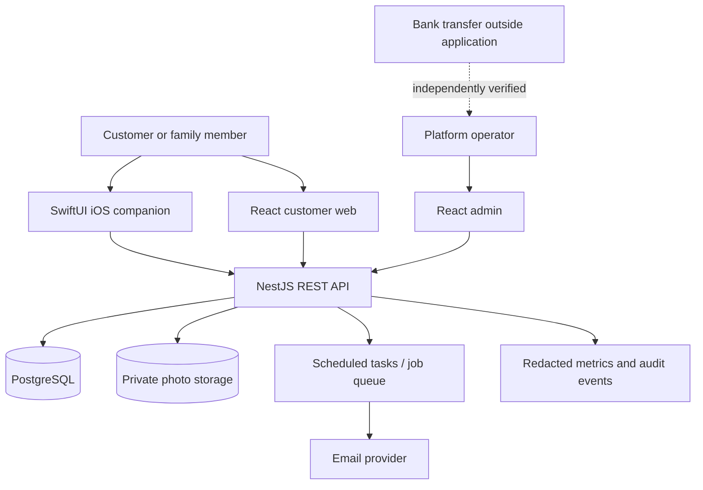
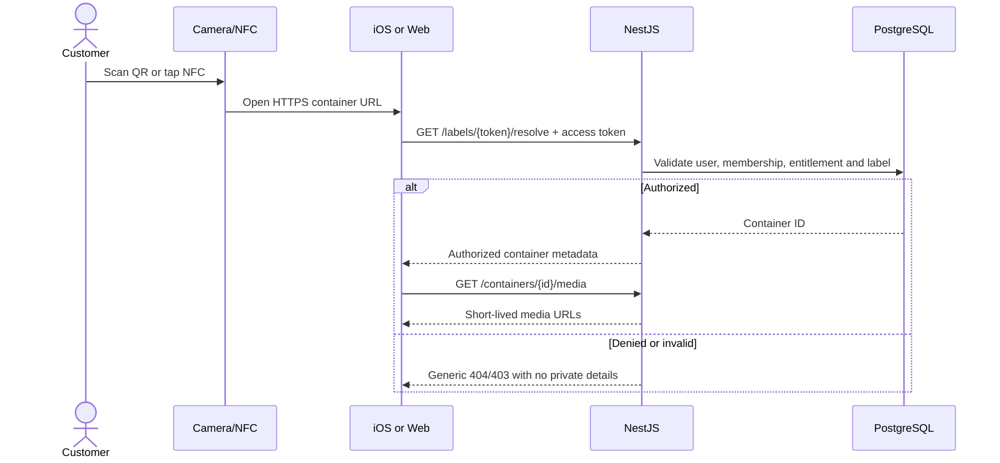

# Technical Solution Architecture

Status: proposed architecture; existing scaffold has partial implementations only.

## 1. Repository and application boundaries

```text
BoxVault/
├── apps/
│   ├── web/             React 19 + TypeScript + Vite + Bootstrap 5
│   │   ├── customer/    inventory / account / WEB-ONLY payment
│   │   └── admin/       separate route tree, auth guards and permissions
│   ├── api/             NestJS + TypeScript + Prisma + PostgreSQL
│   │   ├── auth / tenants / members / locations
│   │   ├── containers / inventory / media / labels
│   │   ├── wallets / topups / subscriptions / plans
│   │   ├── admin / audit / analytics / notifications
│   │   └── prisma/
│   └── ios/             XcodeGen + SwiftUI + AVFoundation + Core NFC
│       ├── App/ Core/ Features/ Resources/
├── packages/
│   ├── assets/          shared first-party brand/logo/static artwork
│   ├── contracts/       OpenAPI specification + generated client conventions
│   └── config/          shared lint/TS/tool configuration
├── docs/
└── infrastructure/
```

There are **not** separate mobile/web databases. All business rules and entitlements are enforced by the NestJS API. Use a modular monolith for MVP, not microservices.

### Central assets

Place **non-user** reusable images, logo SVGs, icon sources and branded templates under `packages/assets/`. React consumes package exports; an iOS build script (later) copies/derives corresponding Xcode asset catalog entries. Never put customers' photo inventory, proofs of payment, bank QR containing actual account data or generated signed URLs in Git. Those belong in private runtime object storage with access policy.

## 2. System context



Recommended future public entry: domain + HTTPS reverse proxy/Cloudflare Tunnel. TLS must remain valid end to end. DB is accessible only to the API service on a private interface.

## 3. Technical stack

| Layer | Technology | Notes |
|---|---|---|
| Customer + admin web | React 19, Vite, TypeScript, Bootstrap 5 | Admin routes share build initially but must have strict server permissions |
| iPhone | Swift 5.10+, SwiftUI, AVFoundation, PhotosUI, Core NFC | iOS 17+ target (scaffold); use Keychain tokens |
| API | Node.js 22, NestJS 11 | API prefix `/api/v1`, validation, guards, interceptors |
| Persistence | PostgreSQL, Prisma 6 | Schema baseline exists; migrations/RLS not implemented |
| Asset/media store | Private S3-compatible or cloud object storage | Choice pending; thumbnails, checksum and quotas |
| Shared contracts | NestJS-generated OpenAPI | Generate typed TS and Swift clients; do not share TS directly with Swift |
| Background work | Queued job processor/cron | Thumbnail generation, email, expiration, reconciliation |
| Reverse proxy | Caddy or equivalent | HTTPS, request limits, safe headers |
| CI | GitHub Actions | TS typecheck/build scaffold; add API tests and macOS iOS build |
| Telemetry | Structured JSON, metrics, error reporting | Redaction by default |

Avoid secrets in `VITE_*` frontend environment variables: they are public at build time.

## 4. Request path and tenant scope

1. Client obtains short-lived bearer access token; browser refresh preferably uses secure HttpOnly cookies with CSRF protection where needed; iOS refresh token in Keychain.
2. Authentication guard validates signature, expiration, issuer, audience and session validity.
3. Membership guard resolves current tenant from an **authorized membership**, never from unchecked user-supplied tenant ID.
4. Domain service executes authorized operation in transaction-scoped tenant context. PostgreSQL RLS provides secondary enforcement.
5. Media URLs generated only after authorization and expire quickly. The actual photo object key is never returned to unauthorized users.
6. Emit minimal audit and metrics records with correlation ID.

An admin service role should have **no `SELECT` privileges on content tables or private object-store access**. Operational database owners/backups may still have privileged access; do not market this setup as cryptographic zero knowledge.

## 5. QR and NFC system

Canonical tag target is an HTTPS URL such as `https://app.example.com/c/<random-token>`. Domain here is a placeholder, **not** a registered BoxVault URL. Token must be CSPRNG-generated, at least 128 bits of randomness, and unique. Store a hash if lookup design permits; never log raw tokens. Neither QR nor NFC stores member IDs or inventory descriptions.



On iOS: AVFoundation reads QR; NDEF URL tags can trigger supported background reading/Universal Links. In-app Core NFC reading requires reader-session handling and entitlement; writing is a separate V1 feature. Test on physical hardware. Scanned labels do **not** bypass login.

## 6. Image and media lifecycle

- Client compresses images and makes thumbnails when appropriate; server enforces size, MIME signature, image decoding and pixel limits.
- Upload design: API issues tenant-authorized, short-lived upload capability, or receives an authenticated multipart request for a smaller pilot.
- Store `tenant_id`, `container_id`, `object_key`, bytes, MIME, checksum and status. Never expose public bucket ACLs.
- Media worker normalizes orientation, strips geolocation EXIF by default and creates multiple sizes. All variants inherit access policy.
- On delete: tombstone metadata and queue removal after documented retention period; backup expiry handled separately.
- Signed download URLs are short-lived. Cache headers must not cause cross-account leakage on shared devices.
- Media cannot be fetched using just an object key without tenant authorization.

## 7. Deployment topologies

**Lean home:** Caddy/Cloudflare Tunnel → NestJS and React → PostgreSQL + locally held media with encrypted off-site backups. Lower cash cost, but single-site power/internet risk and privacy/restore responsibility.

**Preferred hybrid candidate:** public edge → home or small VPS API/DB → **private managed cloud object storage for primary media** plus encrypted DB backups off-site. This reduces home uplink pressure but introduces object storage/egress costs.

**Fully managed:** React static hosting, Cloud Run NestJS, managed PostgreSQL, managed object storage. Highest recurring fixed OPEX, less physical maintenance.

Do not deploy development defaults, default passwords, public PostgreSQL or open storage buckets. See [operations-and-deployment.md](operations-and-deployment.md).

## 8. Evolution path

Initial work follows the current scaffold. Before scaling, split worker into a separately deployed process; maintain a single API contract. Separate the admin web frontend into its own deployment if operational isolation warrants it. Introduce a search index only when PostgreSQL full-text/trigram search is inadequate; all indexes/search results must preserve tenant isolation.

## 9. Key architectural decision records to create later

ADR-001 Authentication/session strategy; ADR-002 media storage provider and URL signing; ADR-003 database tenant isolation and RLS strategy; ADR-004 web-only billing and iOS review; ADR-005 home versus hybrid deployment; ADR-006 encrypted customer content and family key management (future).
